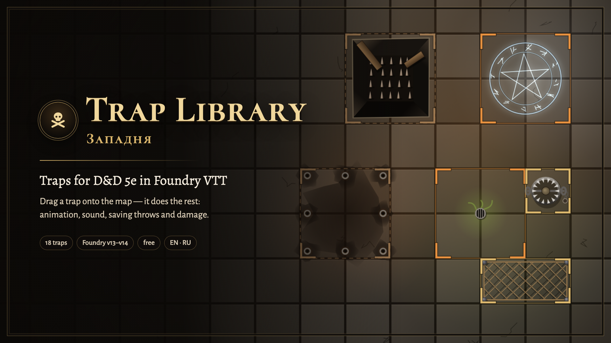

# Западня · Trap Library

[Русский](README.md) · **English**



A trap library for D&D 5e in Foundry VTT, with animations and sounds. The GM drags a trap onto
the map — it becomes a hidden region that fires when a character steps in: an effect on the scene,
a saving throw or an attack, damage with resistances, a condition and a chat card.

## Installation

In Foundry: **Add-on Modules → Install Module**, paste the manifest URL at the bottom:

```
https://github.com/klimenkoyg/foundry-traps/releases/latest/download/module.json
```

- Foundry VTT **v14** (dnd5e 6.x) or **v13** (dnd5e 5.x).
- System: **D&D 5e** — saves, skills, damage and conditions come from it.
- No other modules needed: the animations and sounds are built in. Optionally,
  [Sequencer](https://foundryvtt.com/packages/sequencer) with the free [JB2A](https://foundryvtt.com/packages/JB2A_DnD5e):
  traps then play JB2A effects (you can turn this off in the settings).

## How to use

1. The left Foundry toolbar has its own **Traps** group with a skull (GM only). It works on the
   regions layer: trap outlines are visible and a region can be moved or redrawn. The group has
   Library, My traps and Traps on this scene (each opens the window on that tab) and a toggle for
   the reveal / hide buttons on traps on the map. For quick access there's also a skull button
   on the token controls, and you can bind a key in the controls settings.
2. On the **Library** tab, pick the party level and drag a trap onto the map. It becomes a hidden
   region under the cursor; players don't see it. Click a trap to configure it first.
3. A player character steps in — movement holds while the effect plays; a pit, bear trap, net or
   sleep gas stops it altogether. A trigger card goes to chat: who is hit, how they're checked and
   what they take (see “Triggering” below). A triggered trap gets a marker on everyone's map; a
   single-use trap switches off.
4. The **My traps** tab holds the traps you configured and saved (see below).
5. The **On this scene** tab lists the scene's traps: show one on the map, set it off by hand, try
   to disarm it with the selected token, switch it off or re-arm it, reveal it to players,
   configure it, save it to My traps or remove it.

### My traps

Any trap — from the library or already on the scene — can be changed and saved as your own. When
saving, the module asks **what to call it** (the current name is filled in). Your traps live on
their own My traps tab with the same search and filters: configure them, drag them onto the map,
rename them (the pencil) or delete them. Their damage is stored for levels 1–4 and rescaled to the
party level, like the built-in ones.

- In the configuration window of a built-in trap: “Save to My traps…”; of your own: “Save” (under
  the current name) and “Save as new…”.
- From the scene: the book button next to the trap. If the trap was placed from one of yours, the
  module offers “Update existing” or “Save as new”.
- Your traps are stored in the world (a module setting), shared by every GM of that world.

## Configuring a trap

Click a trap in the library, or the sliders button next to a trap on the scene, to open its
configuration. At the top is the **device**: you describe the trap in in-world terms and the
numbers follow.

| Trap | What you set |
|---|---|
| Pits | depth (1d6 per 10 ft, up to 20d6, same at any party level), what's at the bottom, walls (escape DC) |
| Bear trap | size (damage and escape DC), poisoned teeth |
| Darts | darts per target, venom or a sleeping draught |
| Arrow volley | arrows per target, flaming or poisoned arrowheads |
| Scything blade | where it strikes (legs — knocks prone), speed (attack bonus) |
| Net | rope, weighted, hooked, chain |
| Collapsing roof | gravel, stones or slabs; buries or not |
| Boulder | size, whether it knocks prone |
| Fire and acid jets | pressure; one nozzle or a ring around the whole area |
| Gases | choking, sleeping, acrid smoke, maddening; density (save DC) |
| Runes and sigils | power, from weak to devastating |
| Alarm plate | bell, gong or magic chime |

Below are all of the trap's numbers: DCs, damage, condition, what it takes to escape, area size,
animation, sound and texts. On the right is the card, updating as you go. Place the configured
trap on the map (with the button, or by dragging the card), save it to My traps, or, for a trap
on the scene, save it straight into the region.

**Area size** is width and height in squares, 1 to 12 each: a square, a 1×4 corridor for a
boulder or a blade, a 3×1 strip for a volley. The illustration follows the shape: the tripwire,
the blade slot, the boulder grooves and the dart holes turn along the corridor, rune signs and gas
vents repeat along its length, and the trigger effect stays inside the corridor walls. A trap
also fires on a region of any shape if you redraw it with Foundry's region tools; the marker and
spot range then use the rectangle around it.

## Traps

Hidden Pit, Spiked Pit, Bear Trap, Poison Darts, Arrow Volley, Scything Blade, Falling Net,
Collapsing Roof, Rolling Boulder, Fire Jet, Acid Spray, Poison Gas, Sleep Gas, Lightning Rune,
Frost Rune, Thunder Plate, Withering Sigil and Alarm Plate. The numbers are for levels 1–4; at
5–10, 11–16 and 17–20 damage scales with the SRD 5.1 severity table, DCs stay as written.

## Triggering

The chat card shows every target: why it's hit (“steps on the trap”, “caught in the area”), how it
was checked and what it takes — for example, “Dexterity save: 8 vs DC 13 — failure, full damage ·
will take 9 damage · will be Prone”.

**Damage is rolled once for everyone — after the checks,** like at the table: saves first, then
damage. Until the saves are in, the card shows only the formula (“2d10 poison · rolled after the
saves”). When the last save arrives (or the GM presses “Roll the rest”), damage rolls on its
own — as a separate roll in chat, so everyone sees the dice — and each target shows what it takes.
Don't want to wait for stragglers — the GM has “Roll damage”. Where there's nothing to wait for (an
attack, a trap with no check, the module rolling saves), damage rolls right away.

Two switches, in the module settings and right on the On this scene tab:

- **Saves: players roll** (default) — each target in the card has a “Roll … save” button, visible to the
  character's owner and the GM; the player rolls with the dnd5e dialog (advantage, bonuses) and the
  result lands in the card. For absent players the GM presses “Roll the rest”. Characters
  without a player (monsters) are rolled by the module. **Module rolls** — everything is rolled at
  once, as before.
- **Damage: GM applies** (default) — the GM sees who takes how much and presses “Apply” on a target or
  “Apply to all”; damage goes through resistances, the condition is applied, and the card keeps
  “takes N damage · applied”. **Automatic** — damage and conditions apply as soon as the check
  result is known.

The trap's attack against AC is rolled by the module: it's the trap's own roll. A trap with no
check says “no saving throw” and how much each target takes.

## Spotting and disarming

- **Passive Perception.** A player character notices a trap if their passive Perception meets
  its spot DC, the trap is within its spot range and in line of sight: walls that block
  sight and closed doors get in the way (the “Spot only in line of sight” setting).
- **Searching.** “Search with selected tokens” — the selected tokens roll Perception.
- **Spot range.** Each trap has its own range, 10 ft by default, set in the configuration
  window next to the spot DC. It's counted in squares like the Foundry ruler: from the token's
  edge to the trap's edge, using the scene's diagonal rule. 5 ft is the adjacent square, 10 ft is
  one empty square between, diagonals included; a large token counts from its edge. On a metric
  grid a square still counts as 5 ft.
- **What happens next is up to the “When a character spots a trap” setting** (also switchable
  right on the On this scene tab):
  - **Tell me** (default). Players learn nothing. The GM gets a whisper: who spotted which trap and how
    (passive Perception or a search, with the number and the DC), whether players see it, and
    buttons “Reveal to players”, “Tell just this player” (a whisper to that one player, no map
    marker) and “Show on map”. A notification pops up too, and the trap's map button gets an
    orange dot. If another character spots it later, another message arrives; the scene tab
    shows who has spotted it. A search that finds nothing is reported to the GM only, so the
    player can't guess from the answer.
  - **Reveal right away.** A marker appears on everyone's map; the player and the GM get a whisper.
- **Disarming.** Select a token and press the wrench next to the trap — right on the map (under
  the eye of every armed trap) or on the On this scene tab. A skill or thieves' tools check is
  rolled against the disarm DC; the chat shows the roll vs the DC and what happens next:
  - **meets the DC** — the trap switches off and everyone sees it as disarmed (green check);
  - **fails by less than 5** — nothing happens, the trap stays armed and hidden, try again;
  - **fails by 5 or more** — the trap goes off on whoever was tinkering (an area trap hits everyone
    in the area); the card says “slipped while disarming”.

  Whoever tried to disarm a trap knows about it: they show up under “Spotted by” on the scene tab.

### What players see

Players never see the trap region itself: its colored fill is for the GM only. A spotted trap
shows up for players as an illustration in a severity-colored frame, drawn in the same style as
the animations.

| State | Looks like |
| --- | --- |
| Spotted | What the character noticed: a plank lid with a broken corner and stakes below, open jaws, dart holes, a tripwire and arrow slits, a blade slot, a net overhead, ceiling cracks, boulder grooves, nozzles, gas vents, a glowing rune, a plate with a bell. Unfolds from the center. |
| Spent | What a single-use trap leaves behind: an open pit with stakes and broken planks, shut jaws, arrows and darts in the floor, a net on the floor, rubble, a boulder at the edge, a burnt-out rune. |
| Disarmed | The illustration fades, dashed outline, green check. Only after a successful check: if the GM switches a trap off, players don't see it. |

The illustration follows the device settings: pit depth and what's at the bottom, jaw size and
venom, dart and arrow count, net type, what falls from the ceiling, gas kind and density, rune
power, signal. A custom trap without a device gets a sign instead: a hatched zone and a diamond
with its icon.

The marker lies on the map level, like the floor, and follows fog of war and token vision:
it is hidden in unexplored darkness, dimmed in explored areas that aren't in view right now (the
party remembers where the trap is), and fully visible in view. Tokens are drawn over the marker.
A player sees the trigger effect only if they can see that spot; everyone on the scene hears it.

The GM also sees a faint illustration on traps the players haven't spotted yet.

### Revealing and hiding by hand

The GM decides whether players see a trap — with one click from three places:

- **On the map.** An eye button sits at the top-right corner of every trap: gold means players
  see it, dark with a crossed-out eye means they don't. Click to toggle. Under the eye of an armed
  trap there's a wrench: try to disarm it with the selected token. Only the GM sees these buttons;
  turn them off with the “Trap buttons on the map” setting.
- **On the On this scene tab.** The “Visible to players / Hidden” label on each trap is a toggle.
  Above the list: “Reveal all” and “Hide all”.
- **In chat.** Messages about a spotted trap have a “Reveal to players” or “Hide from players”
  button for the GM.

## Settings

Animations (JB2A if Sequencer is installed, or built-in; built-in only; none), volume, who sets
traps off (player characters only by default, or everyone), who rolls saves (players or the
module), when damage is applied (when the GM clicks or automatically), who sees the trigger card,
passive Perception, spot only in line of sight, when a character spots a trap (tell the GM or
reveal right away), trap buttons on the map (per GM).

## For macros

```js
const traps = game.modules.get("ssl_traps").api;
traps.open();                                    // the GM window
traps.place("fireJet", { x: 1250, y: 850 });     // place a trap (scene point)
traps.playFx("lightning", { x: 1250, y: 850 });  // play an animation without a trap
traps.traps();                                   // traps of the open scene
```

## Development

```bash
npm test          # core tests (node --test)
npm run check     # syntax, translations, templates, sounds, manifest
npm run build     # dist/module.zip and dist/module.json
npm run sounds    # rebuild the sounds (python3)
```

Test benches without Foundry: run `python3 -m http.server 8766` in the repo root, then open
`dev/harness/index.html` (the module on top of a Foundry mock: map, tokens, chat, sound) and
`dev/fx/index.html` (all animations), `dev/markers/index.html` (spotted-trap markers;
`?cell=200&only=pit,bearTrap` for a close look). The benches are in Russian; add `?lang=en` to see
the module itself in English. The bench's “Глазами игрока” (player view) button shows the map the
way a player sees it, with fog of war; a wall with a door splits the rooms (click the door to open
it). What to check in real Foundry: [dev/spikes.md](dev/spikes.md).

## Ideas and bugs

To suggest an idea, use the “Suggest an idea” button at the bottom of the Trap Library window (GM
only) or go straight to the [form](https://forms.gle/FuMwJ2JzSn3DHCTc7). Report bugs in
[Issues](https://github.com/klimenkoyg/foundry-traps/issues).

## Rights

© 2026 Yuriy Klimenko. You may use the module for free in any game, including paid ones, and share
it — complete and unmodified. Changing the code, reusing parts of it in other modules or selling it
requires the author's written consent. Setting up traps and saving your own in the module window is
fine: that is using the module, not changing it. Full terms: [LICENSE](LICENSE).

Trap mechanics follow the SRD 5.1 (Wizards of the Coast, CC BY 4.0); the trap texts, animations and
sounds are original.
