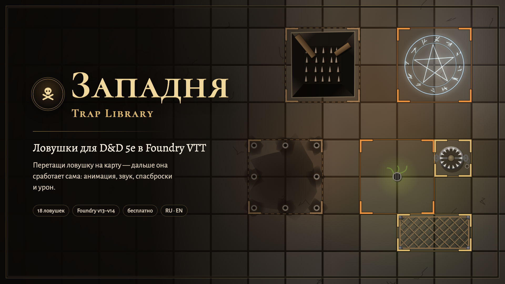
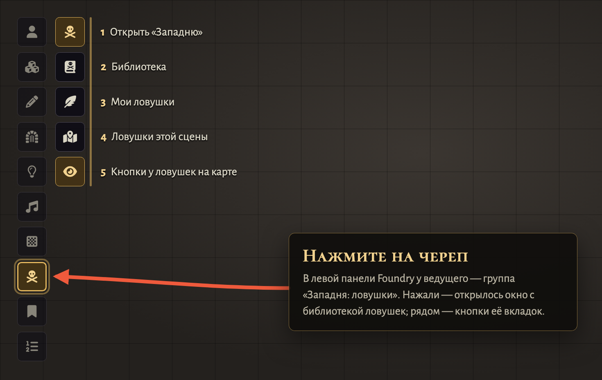

# Западня · Trap Library

| 🐉 **D&D 5e** | 🧭 [Pathfinder 2e](https://github.com/klimenkoyg/foundry-traps-pf) | 🎲 [Any system / Любая система](https://github.com/klimenkoyg/foundry-traps-universal) |
|:---:|:---:|:---:|
| **Русский** · [English](README.en.md) | [Русский](https://github.com/klimenkoyg/foundry-traps-pf#readme) · [English](https://github.com/klimenkoyg/foundry-traps-pf/blob/main/README.en.md) | [Русский](https://github.com/klimenkoyg/foundry-traps-universal#readme) · [English](https://github.com/klimenkoyg/foundry-traps-universal/blob/main/README.en.md) |



Библиотека ловушек для D&D 5e в Foundry VTT, с анимациями и звуками. Ведущий перетаскивает ловушку
на карту — она встаёт скрытой областью и срабатывает, когда на неё наступает персонаж: эффект на
сцене, спасбросок или атака, урон с учётом сопротивлений, состояние и карточка в чате.

## Установка

В Foundry: **Модули → Установить модуль**, внизу окна вставить адрес манифеста:

```
https://github.com/klimenkoyg/foundry-traps/releases/latest/download/module.json
```

- Foundry VTT **v14** (dnd5e 6.x) или **v13** (dnd5e 5.x).
- Система — **D&D 5e**: спасброски, навыки, урон и состояния берутся из неё.
- Сторонние модули не нужны: анимации и звуки свои. По желанию — [Sequencer](https://foundryvtt.com/packages/sequencer)
  и бесплатный [JB2A](https://foundryvtt.com/packages/JB2A_DnD5e): тогда газы, руны, печать, кислота и
  обвал показывают эффекты JB2A, а механические ловушки — свои, где видно само устройство (это
  выключается в настройках).

## Как пользоваться

**Где кнопка:** в левой панели Foundry нажмите на **череп** — это группа «Западня: ловушки» (её видит
только ведущий). Откроется окно с библиотекой ловушек.



1. В левой панели Foundry — своя группа **«Западня: ловушки»** с черепом (только у ведущего).
   Нажали на череп — открылось окно «Западни». В группе — «Библиотека», «Мои ловушки», «Ловушки
   этой сцены» (окно открывается сразу на нужной вкладке) и переключатель кнопок у ловушек на карте.
   Чтобы открывать окно быстрее, в настройках управления можно назначить клавишу.

   У каждой ловушки на карте — два столбика кнопок (только у ведущего): глаз (показать игрокам или
   спрятать), ключ (обезвредить выделенным токеном), ▶ (сработать сейчас); ✥ (перетащить ловушку —
   триггеры внутри неё едут с ней), ↻ (повернуть на 90°: ширина и высота меняются местами,
   триггеры внутри поворачиваются вместе с ней), ⚙ (настройка) и «+» (добавить триггер). Двигать
   ловушки в «Регионы» уходить не нужно; там остаётся только перерисовка фигуры произвольной формы.
   На произвольный угол ловушки и триггеры не поворачиваются: поворот в «Регионах» не применится.
2. На вкладке **«Библиотека»** перетащите ловушку на карту. Она встанет
   скрытой областью под курсором; игроки её не видят. Нажмите на ловушку, чтобы сначала настроить её.
3. Персонаж игрока наступил на ловушку — он останавливается на ней (пройти мимо по длинному пути
   нельзя, остаток хода отменяется), и, когда дошёл, срабатывает эффект. В чат приходит карточка срабатывания: кто под ударом, чем
   проверяется и что получит (см. «Срабатывание» ниже). Сработавшая ловушка отмечается на карте у
   всех, одноразовая — выключается.
4. Вкладка **«Мои ловушки»** — ловушки, которые вы настроили и сохранили (см. ниже).
5. Вкладка **«На этой сцене»** — все ловушки сцены: показать на карте, сработать вручную, попытка
   обезвредить выделенным токеном, взвести или выключить, показать игрокам, настроить, сохранить в
   «Мои ловушки», убрать.

### Мои ловушки

Любую ловушку — из библиотеки или уже стоящую на сцене — можно поменять и сохранить как свою.
При сохранении модуль спрашивает, **как её назвать** (подставлено текущее название). Свои ловушки
живут на отдельной вкладке «Мои ловушки» с тем же поиском и фильтрами: их можно настроить,
перетащить на карту, переименовать (карандаш) и удалить. Урон в них хранится для 1–4 уровня; если
снята галочка «Урон не зависит от уровня», он пересчитывается под уровень партии, как у встроенных.

- В окне настройки встроенной ловушки — «В мои ловушки…»; у своей — «Сохранить» (под текущим
  названием) и «Сохранить как новую…».
- Со сцены — кнопка с книгой у ловушки. Если ловушка поставлена из вашей, модуль предложит
  «Обновить свою» или «Сохранить новой».
- Свои ловушки хранятся в мире (настройка модуля), их видят все ведущие этого мира.

## Настройка ловушки

Окно настройки открывается нажатием на ловушку в библиотеке или кнопкой с ползунками у ловушки на
сцене. Сверху — **устройство**: ловушка описывается словами мира, а числа пересчитываются сами.

| Ловушка | Что настраивается |
|---|---|
| Ямы | глубина (1к6 за каждые 10 фт, до 20к6, от уровня партии не зависит), что на дне, стены (Сл выбраться) |
| Капкан | размер (урон и Сл выбраться), яд на зубьях |
| Дротики | сколько дротиков в цель, яд или сонное зелье |
| Залп стрел | сколько стрел в каждого, горящие или отравленные наконечники |
| Маятник-коса | куда бьёт (по ногам — сбивает с ног), скорость (бонус атаки) |
| Сеть | верёвочная, с грузилами, с крючьями, цепная |
| Обвал | щебень, камни или плиты; заваливает или нет |
| Валун | размер, сбивает ли с ног |
| Струи огня и кислоты | напор; одно сопло или кольцо по всей области |
| Газы | удушливый, сонный, едкий дым, дурманящий; густота (Сл спасброска) |
| Руны и печати | сила: от слабой до разрушительной |
| Сигнальная плита | колокол, гонг или магический звон |

Ниже — все числа ловушки: сложности, урон, состояние, сколько нужно, чтобы выбраться, размер
области, анимация, звук и тексты. Справа — карточка, которая меняется вместе с настройкой.
Настроенную ловушку можно поставить на карту (кнопкой или перетащив карточку), сохранить в
«Мои ловушки», а у ловушки на сцене — сохранить прямо в область.

**Размер области** — ширина и высота в клетках, от 1 до 12 каждая: квадрат, коридор 1×4 под
валун или маятник, полоса 3×1 под залп. Рисунок ловушки ложится по форме: растяжка, щель
маятника, колея валуна и отверстия для дротиков поворачиваются вдоль коридора, знаки рун и
решётки газа повторяются по его длине, вспышка срабатывания не вылезает за стены коридора.
Срабатывает ловушка и по области любой формы, если перерисовать её инструментами регионов
Foundry; метка и «заметить с» тогда считаются по прямоугольнику вокруг неё.

## Ловушки

| Ловушка | Опасность | Чем проверяется | Урон (1–4 ур.) | Состояние |
|---|---|---|---|---|
| Скрытая яма | помеха | ЛВК Сл 12 | 2к6 дробящий | лежащий |
| Яма с кольями | опасная | ЛВК Сл 13 | 2к6 дробящий + 2к6 колющий | лежащий |
| Капкан | помеха | ЛВК Сл 13 | 1к10 колющий | опутанный |
| Отравленные дротики | опасная | атака +6 | 1к4 колющий + 2к6 яд | отравленный |
| Залп из бойниц | опасная | атака +6 по всем в области | 2к6 колющий | — |
| Маятник-коса | опасная | атака +7 | 2к10 рубящий | — |
| Падающая сеть | помеха | ЛВК Сл 10 | — | опутанный |
| Обвал потолка | смертельная | ЛВК Сл 15 | 4к10 дробящий | — |
| Катящийся валун | смертельная | ЛВК Сл 15 | 4к10 дробящий | лежащий |
| Огненная струя | опасная | ЛВК Сл 13 | 2к10 огонь | — |
| Кислотный распылитель | опасная | ЛВК Сл 13 | 2к10 кислота | — |
| Ядовитый газ | опасная | ТЕЛ Сл 13 | 2к10 яд | отравленный |
| Сонный газ | помеха | ТЕЛ Сл 11 | — | бессознательный |
| Грозовая руна | опасная | ЛВК Сл 14 | 3к8 электричество | — |
| Морозная руна | опасная | ТЕЛ Сл 13 | 2к10 холод | — |
| Громовая плита | опасная | ТЕЛ Сл 13 | 2к8 звук | лежащий |
| Печать увядания | смертельная | ТЕЛ Сл 16 | 4к10 некротическая | испуганный |
| Сигнальная плита | помеха | — | — | звонит и сообщает ведущему |

По умолчанию урон одинаковый на любом уровне партии. Если в настройке ловушки снять галочку
«Урон не зависит от уровня», на уровнях 5–10, 11–16 и 17–20 урон растёт по таблице опасности
SRD 5.1 (у опасной ловушки — ×2, ×5 и ×9), а справа в окне настройки видно урон для каждого уровня.
Уровень партии выбирается в библиотеке. Сложность остаётся как в описании.

## Что запускает ловушку

У каждой ловушки один из трёх вариантов — в окне настройки, раздел «Область и срабатывание»:

1. **Сама область.** Ловушка срабатывает, когда в её область заходит персонаж. Так у ям, капкана,
   дротиков, маятника, рун и плит.
2. **Триггеры** — отдельные области, на которые надо наступить; в настройке выбирается, сколько
   их: один, два или три. Они встают в клетки области ловушки, а ведущий перетаскивает каждый куда
   нужно за бирюзовую ручку ✥ на карте (× рядом — убрать). Наступили на триггер — ловушка
   срабатывает и бьёт всех в своей области (наступившего — если он в ней). Ещё один триггер ставит
   «+» у ловушки на карте или кнопка со следами на вкладке «На этой сцене». По одному триггеру
   ставится вместе с залпом, сетью, обвалом, валуном и газами.
3. **Только вручную.** Ловушка не срабатывает от шагов — только по кнопке ▶ у неё на карте (по всем
   в её области) или «Сработать» на вкладке сцены.

Ведущий видит триггеры бирюзовыми — область и контур метки, — и пунктир от каждого к его ловушке;
игроки видят их вместе с ловушкой: плитой, а вытянутый в полосу триггер — растяжкой. Заметить
ловушку можно и по триггеру: «заметить с» считается и от него. Убрали ловушку — убираются и её
триггеры; убрали все триггеры — ловушка снова срабатывает от своей области. В окне настройки
ловушки на сцене число триггеров — столько, сколько их стоит: увеличили — недостающие встанут в её
области, уменьшили — лишние уберутся.

## Срабатывание

Карточка в чате показывает каждую цель: почему она под ударом («наступает на ловушку», «в области
ловушки»), чем проверялась и что получит — например, «спасбросок: Ловкость, 8 против Сл 13 —
провал, полный урон · получит 9 урона · станет: Лежащий».

**Урон бросается один раз на всех — после проверок,** как за столом: сначала спасброски, потом
урон. Пока спасброски не пришли, в карточке только формула («2d10 яда · бросок после
спасбросков»). Когда приходит последний спасбросок (или ведущий жмёт «Бросить за всех»), урон
бросается сам — отдельным броском в чате, кубики видят все — и у каждой цели появляется, сколько она
получит. Не хочется ждать отстающих — у ведущего есть «Бросить урон». Где ждать нечего (атака,
ловушка без проверки, спасброски бросает модуль), урон бросается сразу.

Два переключателя — в настройках модуля и прямо на вкладке «На этой сцене»:

- **Спасброски: бросают игроки** (по умолчанию) — у цели в карточке кнопка «Спасбросок: …». Её
  видят владелец персонажа и ведущий; игрок бросает сам, с окном dnd5e (преимущество, бонусы), и
  итог попадает в карточку. За отсутствующих ведущий жмёт «Бросить за всех». За персонажей без
  игрока (чудовищ) бросает модуль. **Бросает модуль** — всё бросается сразу, как раньше.
- **Урон: по кнопке** (по умолчанию) — ведущий видит, кто сколько получит, и жмёт «Нанести» у цели
  или «Нанести всем»; урон снимается с учётом сопротивлений, состояние накладывается, в карточке
  остаётся «получает N урона · нанесено». **Сразу** — урон и состояние наносятся, как только
  известен итог проверки.

Атаку ловушки по КД бросает модуль: это бросок самой ловушки. Ловушка без проверки пишет
«без спасброска» и сколько получит каждый.

## Обнаружение и обезвреживание

- **Пассивная Внимательность.** Персонаж игрока, подошедший к ловушке, замечает её, если
  пассивная Внимательность не ниже Сл обнаружения, ловушка не дальше её «заметить с» и в прямой
  видимости: стены, закрывающие обзор, и закрытые двери мешают (настройка «Замечать только в
  прямой видимости»).
- **Чем заметить.** В окне настройки ловушки рядом со Сл обнаружения: **Внимательность** (по
  умолчанию) или **Анализ** — для механизмов, которые не видно, пока не начнёшь разбираться:
  щель под плитой, тонкая нить, следы на полу. Тогда персонаж замечает её пассивным Анализом, а в
  сообщении ведущему так и написано: «Анализ (пассивно) 13 против Сл 12».
- **Поиск.** Кнопка «Искать ловушки выделенными» — выделенные токены бросают Внимательность; если
  на сцене есть ловушки, которые замечают Анализом, — ещё и Анализ (бросаем по сцене, а не по тому,
  что рядом, чтобы сам бросок не выдал ловушку).
- **«Заметить с».** У каждой ловушки своя дальность, по умолчанию 10 фт; меняется в окне настройки
  рядом со Сл обнаружения. Считается по клеткам, как линейка Foundry: от края токена до края
  ловушки, с правилом диагоналей сцены. 5 фт — соседняя клетка, 10 фт — через одну пустую клетку,
  в том числе по диагонали; у большого токена — от его края. На метрической сетке клетка тоже
  считается за 5 фт.
- **Что дальше — решает настройка «Персонаж заметил ловушку»** (её же можно переключить прямо на
  вкладке «На этой сцене»):
  - **Сообщить мне** (по умолчанию). Игроки ничего не узнают. Ведущему приходит шёпот: кто
    заметил, какую ловушку и чем (пассивная Внимательность или поиск, с числом и Сл), видят ли её игроки — и
    кнопки «Показать игрокам», «Сообщить только игроку» (шёпот одному игроку, без метки на карте) и
    «Показать на карте». Ещё всплывает уведомление, а кнопка этой ловушки на карте получает
    оранжевую точку. Если потом заметит другой персонаж — придёт ещё одно сообщение; на вкладке
    сцены видно, кто уже заметил. Результат поиска без находок тоже уходит только ведущему, чтобы
    игрок не догадался по ответу.
  - **Показать игрокам сразу.** На карте у всех появляется метка, игроку и ведущему — шёпот.
- **Обезвреживание.** Выделите токен и нажмите ключ у ловушки — прямо на карте (под глазом у
  каждой взведённой ловушки) или на вкладке «На этой сцене». Бросается навык или воровские
  инструменты против Сл обезвреживания. Кто бросает — решает настройка «Обезвреживание» (её же
  можно переключить на вкладке «На этой сцене»):
  - **Бросает игрок** (по умолчанию). Игроку, чей это персонаж, приходит карточка с кнопкой
    «Бросить: Воровские инструменты» — он бросает сам, в окне dnd5e с преимуществом и помехой, как
    спасбросок. У ведущего в той же карточке — «Бросить за игрока», если игрок отошёл. Сложность
    игроку не показывается. За персонажа без игрока ведущий бросает сразу.
  - **Бросает ведущий.** Бросок сразу, как раньше.

  В чате — бросок против Сл и что дальше:
  - **не ниже Сл** — ловушка выключена и видна всем как обезвреженная (зелёная галочка);
  - **не хватило меньше 5** — ничего не происходит, ловушка остаётся взведённой и скрытой, можно
    попробовать ещё раз;
  - **не хватило 5 и больше** — ловушка срабатывает на того, кто копался (ловушка по области — на
    всех в области); в карточке причина «ошибается, обезвреживая ловушку».

  Кто пробовал обезвредить, тот о ловушке знает: его видно в «Заметили» на вкладке сцены.
- **Игрок обезвреживает сам.** Если в настройке «Ключ у игроков» стоит «Есть» (по умолчанию),
  у игрока на карте появляется свой ключ у ловушки — когда он про неё знает и его выделенный
  персонаж стоит в ней или в соседней клетке. «Знает» — значит ловушку показали всем или ведущий
  сообщил именно ему кнопкой «Сообщить только игроку». Если персонаж заметил ловушку, а ведущий
  ещё ничего не решил (режим «Сообщить мне»), ключа нет — иначе он выдал бы ловушку. Игрок жмёт
  ключ и бросает сам; итог проверяет и доводит до конца ведущий: персонаж его, стоит рядом,
  ловушка взведена.

### Что видят игроки

Саму область ловушки игроки не видят никогда: её цветную заливку видит только ведущий. Замеченную
ловушку игроки видят на карте рисунком в рамке цвета опасности — в той же манере, что и анимации.

| Состояние | Как выглядит |
| --- | --- |
| Замечена | Что заметил персонаж: дощатая крышка ямы с проломом и кольями, раскрытый капкан, отверстия для дротиков, растяжка и бойницы, щель маятника, сеть под потолком, трещины свода, колеи валуна, сопла, решётки газа, тлеющая руна, плита с колокольчиком. Проявляется кругом из центра. |
| Сработала | Что осталось у одноразовой ловушки: открытая яма с кольями и обломками досок, захлопнутый капкан, стрелы и дротики в полу, сеть на полу, завал, валун у края, выжженная руна. |
| Обезврежена | Рисунок выцветает, контур пунктиром, зелёная галочка. Только после удачной проверки: если ведущий выключил ловушку сам, игроки этого не видят. |

Рисунок следует за настройкой устройства: глубина ямы и что на дне, размер капкана и яд, число
дротиков и стрел, тип сети, что падает с потолка, вид и густота газа, сила руны, сигнал. У своей
ловушки без устройства вместо рисунка — знак: штриховка зоны и ромб со значком.

Метка лежит на уровне карты, как пол, и подчиняется туману войны и зрению токенов: в
неразведанной темноте её не видно, в разведанной, но не видимой сейчас части карты она
затемнена — партия помнит, где ловушка, — а в поле зрения видна полностью. Токены рисуются поверх
метки. Вспышку срабатывания игрок видит, только если видит это место; звук слышат все на сцене.

Ведущий видит ещё и бледный рисунок у ловушек, которых игроки пока не заметили.

### Показать или спрятать самому

Ведущий решает сам, видят ли игроки ловушку, — в один щелчок из трёх мест:

- **На карте.** У правого верхнего угла каждой ловушки — кнопка с глазом: золотая — игроки видят,
  тёмная с перечёркнутым глазом — нет. Щелчок переключает. Под глазом у взведённой ловушки — ключ:
  попробовать обезвредить её выделенным токеном. Кнопки видны только ведущему; отключаются
  настройкой «Кнопки ловушек на карте».
- **На вкладке «На этой сцене».** Подпись «Видна игрокам / Скрыта» у ловушки — переключатель.
  Над списком — «Показать все» и «Скрыть все».
- **В чате.** В сообщениях о замеченной ловушке у ведущего есть кнопка «Показать игрокам» или
  «Скрыть от игроков».

## Настройки

- **Анимации:** JB2A (если стоит Sequencer) или свои; только свои; без анимаций.
- **Громкость** звуков ловушек.
- **На кого срабатывают:** только на персонажей игроков (по умолчанию — ведущий спокойно водит
  чудовищ) или на всех.
- **Кто бросает спасброски от ловушек:** игроки кнопкой в карточке или модуль сразу.
- **Когда наносить урон ловушки:** по кнопке ведущего или сразу.
- **Карточка срабатывания:** видна всем или только ведущему (и владельцам целей, если спасброски
  бросают игроки).
- **Пассивная Внимательность**, **замечать только в прямой видимости**,
  **персонаж заметил ловушку**: сообщить ведущему или показать сразу.
- **Кто бросает обезвреживание:** игрок кнопкой в карточке (по умолчанию) или ведущий сразу.
- **Игроки сами обезвреживают замеченные ловушки:** свой ключ у игрока на карте (включено).
- **Кнопки ловушек на карте** — у каждого ведущего своя.
- **Сообщать о новых версиях** (у каждого ведущего своя, включено). При входе в мир (не чаще раза
  в час) модуль спрашивает GitHub, вышла ли новая «Западня». Если вышла — ведущему всплывает окошко: что нового и как
  обновить; «Понятно» — больше не показывать для этой версии, «Напомнить завтра» — через сутки.
  Игроки ничего не видят. Выключить — и модуль никуда не обращается.

## Для макросов

```js
const traps = game.modules.get("ssl_traps").api;
traps.open();                                    // окно ведущего
traps.place("fireJet", { x: 1250, y: 850 });     // поставить ловушку (точка сцены)
traps.playFx("lightning", { x: 1250, y: 850 });  // показать анимацию без ловушки
traps.traps();                                   // ловушки открытой сцены
```

## Разработка

```bash
npm test          # тесты ядра (node --test)
npm run check     # синтаксис, переводы, шаблоны, звуки, манифест
npm run build     # dist/module.zip и dist/module.json
npm run sounds    # пересобрать звуки (python3)
```

Стенды без Foundry: `python3 -m http.server 8766` из корня, затем
`dev/harness/index.html` — модуль поверх имитации Foundry (карта, токены, чат, звук) и
`dev/fx/index.html` — все анимации, `dev/markers/index.html` — метки замеченных ловушек (`?cell=200&only=pit,bearTrap` — крупно и выборочно). На стенде
кнопка «Глазами игрока» показывает карту так, как её видит игрок, с туманом войны; между комнатами
стена с дверью (щелчок по двери открывает её). Что проверить в настоящем Foundry — в [dev/spikes.md](dev/spikes.md).

## Идеи и ошибки

Предложить идею — кнопка «Предложить идею» внизу окна «Западни» (у ведущего) или сразу
[форма](https://forms.gle/FuMwJ2JzSn3DHCTc7). Об ошибках — в
[Issues](https://github.com/klimenkoyg/foundry-traps/issues).

## Права

© 2026 Yuriy Klimenko. Модулем можно бесплатно пользоваться в любых играх, в том числе платных,
и делиться им — целиком и без изменений. Менять код, брать части модуля в другие модули и продавать
его — только с письменного согласия автора. Настраивать ловушки и сохранять свои в окне модуля
можно свободно: это пользование, а не изменение. Полные условия — в [LICENSE](LICENSE).

Механика ловушек опирается на SRD 5.1 (Wizards of the Coast, CC BY 4.0); тексты ловушек, анимации
и звуки — собственные.
